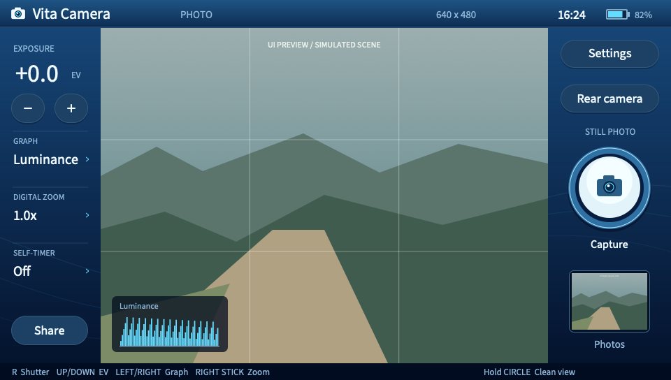

# Vita Camera

C++17 photo app for a homebrew PS Vita. Blue glass panels, native 4:3 framing, touch controls and physical shortcuts. Built natively with VitaSDK.



## Features

- Rear/front camera, VGA ABGR capture; tries 60 fps, falls back to 30 fps.
- EV compensation, WB presets, ISO and anti-flicker.
- Original, Mono, Warm and Cool looks. Hold SELECT to compare.
- 2/10-second timer, thirds/square guides, highlight/shadow warnings.
- Luminance/RGB histograms and waveform, measured within the zoomed frame.
- Right-stick digital zoom from 1–4×. Zoomed captures save a separate copy beside the full-frame original.
- Photo browser: newest first, swipe or use Left/Right; hold Select for the full-frame original.
- Wi-Fi sharing to iPhone Safari through a QR code; no SD-card removal or companion app.
- Mirrored selfie preview; exports remain unmirrored.
- Lossless 640 × 480 PNG originals, optional edited copies and JSON settings.
- Background saving, retained failed captures for retry, persistent preferences.

Files live in `ux0:data/VitaCamera/photos`. Color looks never overwrite the original. Camera settings affect both versions; “original” means the delivered camera image before app processing, not RAW. Guides, warnings and UI stay out of exports.

ISO offers Auto, 100, 200 and 400. Saved metadata records the selected mode, not a measured exposure value. The public Vita camera API exposes no autofocus or manual lens-focus adjustment. Digital zoom can help inspect detail; it does not refocus the lens.

## Reading the graphs

| Graph | What it shows |
| --- | --- |
| Luminance | Brightness distribution: dark pixels on the left, bright pixels on the right. Taller bars mean more pixels at that brightness. |
| RGB | Separate red, green and blue distributions. A channel crowded against the right edge can indicate lost color detail. |
| Waveform | Image position from left to right, brightness from bottom to top. Brighter marks mean more pixels at that position and brightness. |

Graphs follow the current color look and zoomed framing, before warning overlays. They refresh at 10 Hz; Left/Right cycles through them and Off. Histogram heights are normalized within each graph.

**Highlight zebras** mark pixels with any channel at 250/255 or above. **Shadow warnings** mark luma at 5/255 or below. They help locate possible clipping; they do not recover detail. Both are preview only.

## Controls

| Control | Action |
| --- | --- |
| R / Cross | Shutter; cancel timer; retry failed save |
| Up / Down | Increase / decrease EV |
| Left / Right | Previous / next graph |
| Right stick Up / Down | Zoom in / out (1–4×) |
| Front / Rear camera button | Switch camera (touch) |
| Square | Photo browser |
| Triangle | Settings |
| Hold Circle | Clean view while held |
| Circle in menus / during timer | Back / cancel timer |
| Hold Select | Compare original |
| Start | Controls |
| Settings: Up / Down | Select row |
| Settings: Left / Right / Cross | Change value |
| Settings: L / R | Switch tab |
| Review: Cross | Toggle 2x detail |
| Review: Left / Right or swipe | Previous / next photo |
| Review: left stick | Pan when zoomed |

Touch the controls directly; hold the viewfinder for clean view and release to restore the UI. L has no action while shooting; L/R still switch Settings tabs. A Circle press used to go back or cancel a timer does not also hide the UI. Wait for **Photo saved** before closing the app. If saving fails, keep the app open and press Capture to retry the retained frame.

## Share to iPhone

1. Connect the Vita and iPhone to the same Wi-Fi network, or connect the Vita to your iPhone's Personal Hotspot.
2. Tap **Share** on the camera or photo-browser screen.
3. Scan the QR code with iPhone Camera and open the link in Safari.
4. Touch and hold a photo to save it to Photos. **Download PNG** saves a file; **Full original** opens the unedited, uncropped image.

Keep Share open until the transfer finishes. Circle stops the local server. Sharing exposes only completed app photographs through a new session link each time. Networks that isolate connected devices will block this connection.

### Away from home

On iPhone, open **Settings → Personal Hotspot → Allow Others to Join**. Enable **Maximize Compatibility** when available, then join that network in the Vita's **Settings → Network → Wi-Fi Settings**. Return to Vita Camera, open Share and scan the QR code. [Apple's hotspot guide](https://support.apple.com/en-us/111785) covers setup; [compatibility mode](https://support.apple.com/en-ca/guide/security/secfd166f620/web) selects 2.4 GHz and WPA2 on supported iPhones.

The photographs travel locally between the devices. The app needs no internet connection, but iPhone hotspot availability requires cellular data and carrier support. Do not assume it will be available without service. A compatible router/access point can provide a local network without internet; that path and iPhone hotspot still need device validation here.

USB through VitaShell to a computer also works without removing the SD card: copy `data/VitaCamera/photos` from the exported SD2Vita, then safely eject. Direct USB to iPhone is untested; iPhone supports [compatible external storage](https://support.apple.com/guide/iphone/external-storage-devices-iph95baac91f/ios), but that does not establish compatibility with VitaShell's USB device.

Bluetooth photo transfer is not implemented: [Sony's supported Bluetooth profiles](https://manuals.playstation.net/document/en/psvita/settings/bluetooth.html) do not include a file-transfer profile. Wi-Fi is the supported transfer path.

## Native build

Install [VitaSDK](https://vitasdk.org/) for your host. This project uses the 2026.08 series and requires `libvita2d`, `libpng`, `libjpeg-turbo`, `zlib`, `freetype` and `bzip2`:

```sh
export VITASDK=/path/to/vitasdk
export PATH="$VITASDK/bin:$PATH"
vdpm install libvita2d libpng libjpeg-turbo zlib freetype bzip2
sh scripts/build.sh
```

Without `VITASDK`, the script uses `.toolchain/vitasdk` in this repository. Output: `dist/vita-cam.vpk`. No Docker is used for builds or tests.

Assets are included. To regenerate them, install Pillow in a virtual environment and run `scripts/artwork.py`.

The UI uses 4× MSAA and [Source Sans 3](https://github.com/adobe-fonts/source-sans), rasterized at each text size. Its [OFL license](assets/fonts/LICENSE.md) ships with the app.

QR codes use [Nayuki's QR Code generator v1.8.0](https://github.com/nayuki/QR-Code-generator/tree/v1.8.0/c), bundled under its [MIT license](third_party/qrcodegen/LICENSE.txt).

## Install

1. In VitaShell, press START, set **SELECT button → USB**, close the menu and press SELECT.
2. Set **USB device** to the storage you use (for example, SD2Vita). Copy `dist/vita-cam.vpk` to that drive's root as `VitaCamera.vpk`. Eject the drive on the computer.
3. Press Circle on the Vita to stop sharing. Find `VitaCamera.vpk` at the root of that storage in VitaShell and install it. An exported Memory Card may be mounted as `uma0:` rather than `ux0:` when SD2Vita is active.
4. Launch **Vita Camera** from LiveArea.

Updating the same title (`VITACAM01`) preserves photographs in the separate data directory.

## Checks

With CMake, a native C++ compiler, libpng and FreeType:

```sh
sh scripts/check.sh
```

Seven suites cover exports, preview pixels (NEON and scalar), text alignment, background saves, the gallery and HTTP sharing. HTTP tests need a local loopback socket. The shared C++ layout produces `build-host/*.svg` with a simulated scene. `build-host/sharing_preview` serves generated sample images for browser checks; press Enter to stop it.

## Project guide

- [Architecture](docs/architecture.md): modules, rendering and capture ownership.
- [Performance](docs/performance.md): benchmark and optional Vita timing logs.
- [Device checks](docs/device-testing.md): verified behavior and remaining checks.
- [Research brief](vita-cam.md): hardware capabilities and future experiments.

Build output, the local SDK, device logs and rollback packages are ignored by Git. Source lives in `src/` and `include/`; checks in `tests/`; packaged artwork and fonts in `assets/`.
